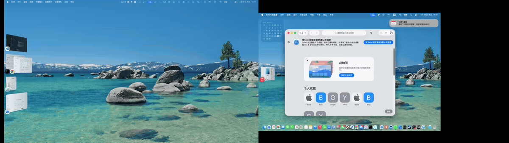

# macOS 跨屏窗口等比例缩放

[中文](README.md) · [English](README.en.md)

基于 Hammerspoon 的多显示器窗口工具。在窗口被拖到另一块显示器并松开鼠标后，按目标屏幕的可用区域调整窗口大小和位置，尽量保持原有的占屏比例，减少手动调整。

适合同时使用 Mac 内置屏幕与外接显示器、屏幕可用尺寸不同，并习惯窗口化工作的用户。插件及安装目录名称仍为 `ProportionalResize.spoon`。

## 使用效果



## 主要功能

| 模块 | 功能 |
| --- | --- |
| 跨屏缩放 | 根据窗口在原屏幕上的宽、高占比，计算目标窗口尺寸。 |
| 位置映射 | 保留相对位置，并对目标位置和尺寸进行边界限制。 |
| 触发时机 | 按下鼠标时记录窗口信息，松开后检查是否跨屏；拖动过程中不执行缩放。 |
| 配置 | 支持排除指定应用，以及设置缩放动画时长。 |
| 安装与卸载 | 提供脚本安装、更新和清理配置，也支持手动安装。 |

典型流程：按住窗口 → 拖到另一块屏幕 → 松开鼠标 → 自动调整窗口大小和位置。

“等比例”指窗口宽、高分别占屏幕可用区域的比例。两块屏幕宽高比不同时，窗口自身的宽高比可能变化；应用最小窗口尺寸等限制也可能影响最终效果。本工具不修改应用内部的字体或页面缩放比例。

## 技术栈

| 模块 | 技术 |
| --- | --- |
| 窗口逻辑 | Lua、Hammerspoon Spoon |
| 鼠标与窗口 | `hs.eventtap`、`hs.window`、屏幕可用区域映射 |
| 安装与卸载 | Bash、Git |

## 项目结构

```text
.
├── init.lua          # 鼠标事件和窗口跨屏映射
├── install.sh        # 安装或更新，添加加载配置
├── uninstall.sh      # 删除插件及标记内的配置
├── assets/demo.gif   # 使用演示
├── README.md
└── README.en.md
```

## 环境要求

- macOS，至少两块显示器。
- 已安装 [Hammerspoon](https://www.hammerspoon.org/)，并授予辅助功能权限。
- 脚本安装需要 Git，默认检查 `/Applications/Hammerspoon.app`。

```sh
brew install --cask hammerspoon
```

权限位置：系统设置 → 隐私与安全性 → 辅助功能 → 启用 Hammerspoon。

## 安装

### 脚本安装

```sh
curl -fsSL https://raw.githubusercontent.com/snowoutwhite/ProportionalResize.spoon/main/install.sh | bash
```

脚本将插件下载到 `~/.hammerspoon/Spoons/ProportionalResize.spoon`，并向 `~/.hammerspoon/init.lua` 添加带标记的加载配置。已有 Git 仓库时执行快进更新，已有配置标记时不重复添加。

若命令行工具 `hs` 可用，脚本会尝试重载配置；否则从 Hammerspoon 菜单选择 **Reload Config**。

### 手动安装

```sh
git clone https://github.com/snowoutwhite/ProportionalResize.spoon.git \
  ~/.hammerspoon/Spoons/ProportionalResize.spoon
```

在 `~/.hammerspoon/init.lua` 中添加以下内容，然后重载：

```lua
-- >>> ProportionalResize >>>
hs.loadSpoon("ProportionalResize")
spoon.ProportionalResize:start()
-- <<< ProportionalResize <<<
```

## 配置

在 `start()` 前设置选项，修改后重载：

```lua
-- >>> ProportionalResize >>>
hs.loadSpoon("ProportionalResize")
spoon.ProportionalResize.animationDuration = 0.1
spoon.ProportionalResize.excludedApps = { "iTerm2", "Terminal" }
spoon.ProportionalResize:start()
-- <<< ProportionalResize <<<
```

| 配置项 | 默认值 | 含义 |
| --- | --- | --- |
| `animationDuration` | `0` | 动画时长，单位为秒；`0` 为立即调整。 |
| `excludedApps` | `{}` | 要排除的应用名称列表。 |

## 工作原理

1. 按下鼠标时，查找指针下最上层的标准窗口，记录窗口 ID、屏幕 ID，以及相对屏幕可用区域的位置和尺寸。
2. 松开鼠标时，检查同一个窗口是否跨屏；屏幕未变化则不调整。
3. 若已跨屏，将记录的相对位置及宽高占比映射到目标屏幕，限制目标边界后设置窗口区域。

主要面向普通窗口的鼠标跨屏拖动，不主动切换全屏或创建 Spaces，也不会响应仅通过键盘或其他工具完成的窗口移动。

## 卸载

```sh
curl -fsSL https://raw.githubusercontent.com/snowoutwhite/ProportionalResize.spoon/main/uninstall.sh | bash
```

删除插件目录及 `init.lua` 中起止标记之间的配置，包括该标记块内的自定义选项。完成后重载 Hammerspoon。

## 许可证

[MIT](LICENSE)
